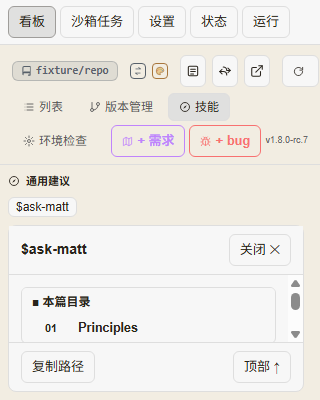
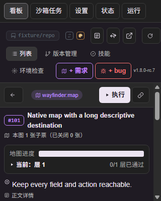
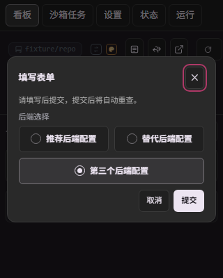

# 静态视觉候选双轴审查

范围：[规格 #106](https://github.com/wozhendeshifwa/matt_pocock_plugin/issues/106)、基础契约 #107、皮肤 #108，以及同一集成分支的地图模式／持续执行提示词。比较基线为已验收 `main` 的 `37ba29766ad03162a499d28b6c0b695324be0ad4`；本轮在固定提交审查后追加工作区候选增量审查，未纳入 `GLOSSARY.md`、issue96/100 调查记录或抛弃式原型。

原始规格与检查接缝分别见 `native-visual-design-spec-2026-11-28.md`、`native-visual-static-acceptance-2026-11-28.md`；实现红绿证据和未测范围见 `native-visual-surfaces-2026-11-28.md`。

## Standards

独立 Standards 代理最终结论：没有未解决的仓库标准违例或需单列的代码异味。地图 adapter 仅增加两个呈现属性，使用唯一锚点并在边界变化时构建失败。schema 使用限定在真实弹窗内的 `:has(> label[role=radio])` 选择器修正换行；未改变事件、键盘、单选状态、提交、数据或 RPC。共享 Chromium 驱动避免重复维护。

审查识别的目录 hover、有序列表序号及状态配色问题转交 Spec 轴和实施修复，未将其混同为标准违规。不可达的遗留技能筛选规则仅作兼容覆盖，没有伪造当前生产控件的测试。

## Spec

独立 Spec 代理最终结论：静态候选审查通过，没有未解决的可行动发现。审查中实际复现并修复的项目：顶层页签选中态被覆盖、代码配置框等宽规则失效、schema 单选组在 320×400 溢出、暗色技能错误图标低对比。目录真实 hover、有序列表编号配色也补充了针对性回归。

schema 回归通过生产环境检查动作链打开表单，验证边界、选项切换和单选语义；没有把抽取私有函数的诊断夹具作为最终公开接缝测试。最终检查为 80 个布局及两个明暗技能错误状态。代表受控截图：

| 浅色技能详情，320×400 | 深色地图，320×400 | 深色单选表单，320×400 |
| --- | --- | --- |
|  |  |  |

以上图片来自受控 Chromium，RPC／沙箱服务为夹具，不是 Codex 原生观察。完整罕见确认及沙箱详情等未测项保留在实施记录，不用共享样式覆盖冒充逐状态通过。

## 验证和原生边界

本机完整 `npm run check` 两轮通过；Windows symlink 权限一项按既有条件跳过。末轮审查修复后，主代理再次独立运行基础配色探针与最终 82 布局／状态探针，均通过。既有 VC 样式代表检查通过，精确视口边界以实施记录为准。最终提交的双平台 CI 另以 PR 实际检查结果为准。

本审查不包含候选在 Codex 的原生加载／静态验收，也不包含继续明确暂停的动态主题闪烁调查。PR 维持草稿；没有部署、重启或切换运行服务，没有合并。原生候选验证由 #109 继续：先获得具体版本加载所需的运行服务重连授权，再核对实际资源 URI 和 DOM 三资产哈希，随后安全读取页面与状态。

两轴汇总：Standards 未解决 0，Spec 未解决 0；原生验收和动态暂停边界不被改写为已完成。
